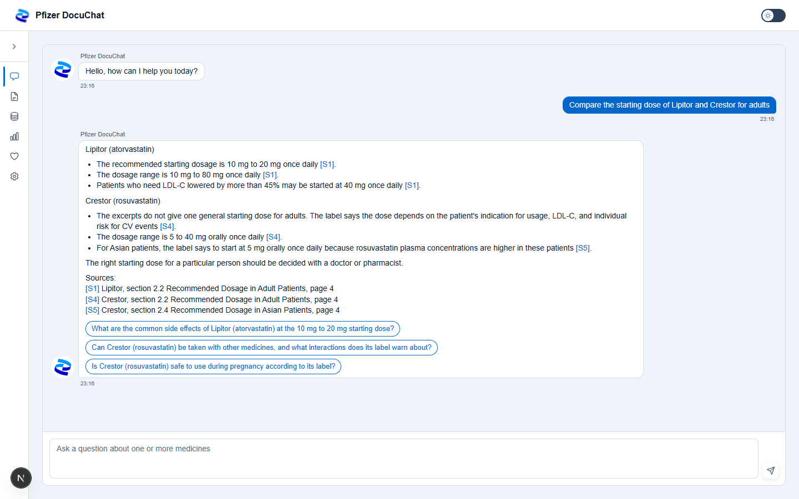

# DocuChat

## Overview

DocuChat answers questions about prescription drug labels. It uses only the label text in its library. Each answer cites the label passages that it uses.

The library holds drug labels from DailyMed (the US National Library of Medicine). The first start loads 50 labels. You can add more labels from the Corpus page. The measurements below use a library of 53 labels.

What DocuChat does:

- It finds the drugs that the question names, and it searches only the labels of these drugs.
- It writes an answer with a citation for each fact. When you click a citation, the PDF viewer opens the label at the cited passage.
- It checks the answer before you see it. A sentence with a number must cite a passage that holds that number.
- It refuses when the labels do not answer the question, or when the question names a drug that is not in the library.
- It asks a question back when a name is not clear. Example: "Ozempic" has a tablet label and an injection label.

DocuChat does not give medical advice. It reports what the label says.



## Architecture

The repository has three deployable parts and one docs folder:

| Folder | Holds |
|---|---|
| `backend/` | FastAPI API, the LangGraph chat graph, the ingest worker, evals |
| `frontend/` | Next.js app with the `@geomak/ui` component library |
| `infra/` | The Compose stack, the setup scripts, preflight, Prometheus and Grafana |
| `docs/` | Diagrams, screenshots, start modes |

Services in `infra/docker-compose.yml`:

| Service | Job |
|---|---|
| `preflight` | Checks the `.env` files before the other services start |
| `db` | ParadeDB (Postgres 18 with `pg_search` for BM25 and `pgvector` for vectors) |
| `storage` | SeaweedFS with the S3 API. It holds the label PDFs and XML files. |
| `cache` | Redis 7.2. It holds question embeddings, model replies, thumbnails and model lists. |
| `backend` | The API. It applies the database migrations at start. |
| `ingest-worker` | Downloads, parses, chunks and embeds the labels |
| `corpus-init` | Runs once. It puts the labels of `backend/corpus/manifest.json` into the label queue. |
| `prometheus`, `grafana` | Metrics and one dashboard |
| `frontend` | The web app. Its proxy route forwards `/api/*` to the backend. |

The browser calls only the frontend. The one exception is the pdf.js worker, which loads from the jsdelivr CDN.

### How an answer is made

The chat graph is in `backend/app/application/chat/graph.py`. Each turn goes through these steps:

1. **guard**: plain code checks the question for size and for known prompt-injection words.
2. **intake**: a model replies to small talk, or writes a search query and names the medicines in the question.
3. **retrieve**: plain code finds the drugs and searches their labels.
4. **clarify**: when a name matches more than one drug or form, the user gets a question back.
5. **grade**: a model keeps the relevant passages. If none is relevant, the graph writes a new query and searches one more time.
6. **generate**: a model writes the answer from the passages, with citations.
7. **validate**: plain code checks the citations and the numbers.
8. **suggest**: a model proposes follow-up questions.

Search is hybrid. A vector search (pgvector, HNSW) and a keyword search (ParadeDB BM25) run on the same labels. Reciprocal rank fusion joins the two result lists. An answer gets at most 8 passages and 3500 tokens. When one search fails or takes more than 5 seconds, the other search continues alone.

Labels are split by their sections from the SPL XML file. The page numbers come from the PDF. Each chunk has about 500 tokens. A chunk inside a table keeps the table caption and the header row.

Diagrams of the system, the backend layers, ingestion, retrieval and the database are in `docs/diagrams/`.

### Backend layers

- `app/domain` has the models and the ports. It imports no framework.
- `app/application` has the services and the chat graph. It uses the ports only. Only `chat/graph.py` imports LangGraph.
- `app/infrastructure` has the adapters: Postgres, S3, Redis, OpenRouter, DailyMed, Langfuse, PDF parsing.
- `app/api` has the FastAPI routes. All routes are under `/api/v1`.
- `app/worker` has the ingest worker and corpus-init. It does not load LangGraph or FastAPI.

## Getting started

You need:

- Docker with Compose v2.
- An OpenRouter API key.

Step 1. Create the `.env` files. Run this from the repository root:

```sh
infra/setup.sh
```

On Windows, run `infra\setup.ps1`. The script creates `backend/.env`, `infra/.env` and `frontend/.env` from their examples. Then it stops and asks for the API key.

Step 2. Type your key into `OPENROUTER_API_KEY` in `backend/.env`. The other values work for a local run. Run the setup script again. It must show OK for each check.

Step 3. Start the stack:

```sh
docker compose -f infra/docker-compose.yml up
```

On the first start, the worker downloads and ingests the 50 labels of the manifest. In a clean clone test this took 393 s and made 3748 chunks. The Corpus page shows the progress. The embeddings for 53 labels cost about 0.025 USD.

Step 4. Open the app:

| What | URL |
|---|---|
| App | http://localhost:3000 |
| API docs | http://localhost:8000/api/v1/docs |
| Grafana | http://127.0.0.1:3001 |
| Prometheus | http://127.0.0.1:9090 |

The ports are in `infra/.env`.

To remove the stack and all its data:

```sh
docker compose -f infra/docker-compose.yml down -v
```

## Configuration

Each part has its own `.env` file. Each variable is in one file only. The examples are `backend/.env.example`, `infra/.env.example` and `frontend/.env.example`.

| File | Holds |
|---|---|
| `backend/.env` | The OpenRouter key, the models, the embedding model, the storage bucket, Langfuse, `WEB_CONCURRENCY`, and the Tuning section |
| `infra/.env` | The Compose project name, the Postgres and S3 credentials, the Grafana password, the host ports, `DB_SHM_SIZE` |
| `frontend/.env` | The links on the Health page, and the backend URL for a run outside Docker |

Models (OpenRouter model IDs):

| Step | Model |
|---|---|
| intake, rewrite, grade | `anthropic/claude-haiku-5.5` |
| generate | `anthropic/claude-opus-5.5` |
| embeddings | `openai/text-embedding-3-small`, 1536 dimensions |

The Settings page can change the models, the chunk size, the search limits and the answer check while the app runs.

Every tunable number is a required variable in the Tuning section of `backend/.env.example`. There are 76 of them: the database pool, timeouts, cache lifetimes, model limits, search limits, detector thresholds, worker intervals and DailyMed pacing. The code has no default for them. Preflight and the setup scripts stop when one is empty.

`COMPOSE_PROJECT_NAME` must be different for each checkout on one machine. The setup scripts stop when another checkout uses the same name.

Langfuse tracing is optional. To turn it on, set `LANGFUSE_PUBLIC_KEY`, `LANGFUSE_SECRET_KEY` and `LANGFUSE_HOST` in `backend/.env`. Each chat turn then sends one trace, with the user question and the answer. Each conversation is one Langfuse session.

## Development

The stack runs in development mode only. The backend and the frontend reload when you change a file.

Backend checks, from the repository root:

```sh
docker compose -f infra/docker-compose.yml exec backend sh -c "ruff check . && ruff format --check . && mypy && pytest && bandit -c pyproject.toml -r app && python -m app.api.contract --check"
```

Frontend checks, in `frontend/`:

```sh
npm run lint && npm run format:check && npm run typecheck && npm test && npm run contract:check
```

### API contract

The backend is the source of the contract.

- `python -m app.api.contract` (in the backend container) writes `backend/contract/`.
- `npm run contract:generate` (in `frontend/`) writes `frontend/src/lib/contract/generated.ts`. Do not edit this file.
- CI fails when either file is out of date.
- Contract changes are additive only. A removed or renamed field needs a new API version.

### Database migrations

Only the API applies the migrations, at start. The ingest worker and corpus-init check that the schema is current. If it is not current, they stop with a message, and the worker restarts until the API has applied the migrations.

### CI

GitHub Actions has two workflows. `backend.yml` runs on changes in `backend/`. `frontend.yml` runs on changes in `frontend/` and `backend/contract/`. Each workflow runs the checks above. CI does not build or publish images.

## Testing

Results on 2026-11-24:

- Backend: 580 passed, 4 xfailed. The 4 xfailed tests are reworded prompt-injection attacks that the plain-word guard does not stop.
- Frontend: 131 passed (2026-11-23).

## Evaluation

The evals are in `backend/evals/`. Run them in the backend container. Results go to `backend/evals/results/`.

| Eval | Command | Result |
|---|---|---|
| Retrieval set, 578 generated questions, no LLM calls | `python -m evals.retrieval_set` | recall@8 0.969, MRR 0.93 |
| Golden set, 28 reviewed cases with reference answers | `python -m evals.run --label <name>` | 24 of 28 passed (run 6) |
| Drug detector calibration, 654 cases | `python -m evals.detector_calibration` | 0 wrong drugs, 0 missed one-edit typos, 16 clarify questions |
| Citation highlight on all 3956 chunks | `python -m evals.export_anchors`, then `npm run eval:anchors` in `frontend/` | the viewer finds 80.1% of the passages |

Golden run 6 in detail: an LLM judge scored all answered cases as correct. Citation validity is 1.0 and number grounding is 1.0. The median time is 5.9 s, and the cost is 0.38 USD for the 28 cases. The 4 failures are refusals from the strict number check: three questions about ages, and one Januvia question that passes in some runs.

The retrieval set misses 18 of 578 questions. 16 of these are Ozempic questions that get a clarify question by design. 2 are real misses on drug interaction comparisons.

Load test (2026-11-22): 4 API processes, 2000 synthetic labels (149,920 chunks) and a fake model server gave 21.5 chat turns per second at 200 users, with a p95 of 9.7 s. The load test setup is local only and is not in git.

## Corpus

`backend/corpus/manifest.json` lists 50 labels. All labels use the PLR layout (the label format of 21 CFR 201.57). The set includes boxed warnings, drug class pairs and look-alike names (for example Celebrex and Celexa), so the tests cover hard cases. Details are in `backend/corpus/README.md`.

A product is its active ingredients plus its dosage form. When the library has more than one label for a product, the search uses one preferred label: the brand label first, then the newest label.

## Key technical decisions

**One database for data, vectors and keywords.** ParadeDB is Postgres with `pgvector` and `pg_search` (BM25). The labels, the chunks, both search indexes, the conversations and the label queue are in one database. Both search legs filter by label inside the index, so a question about one drug never reads the chunks of other drugs. The cost: ParadeDB is not a managed service on the large clouds (see "Productionize on AWS").

**Hybrid search with reciprocal rank fusion.** Drug labels have exact terms (doses, drug names, section titles) and also lay questions ("what side effects does it cause"). BM25 finds the exact terms, and the vectors find the meaning. Rank fusion joins the two lists without score calibration. The generated retrieval set measures recall@8 0.969 and MRR 0.93.

**Chunks follow the label sections.** The SPL XML file of each label gives the section tree, and the PDF gives the page numbers. A chunk never crosses a section, and a chunk inside a table keeps the table caption and the header row. This makes each citation point to one section and one page. Only labels in the PLR layout are in the library, because the six labels in the older layout failed ingestion.

**Plain code around the model steps.** The graph has model steps (intake, grade, generate, suggest) and plain code steps (guard, retrieve, validate). The plain code steps decide what is allowed: which drugs the search reads, and which answer the user sees. Only `app/application/chat/graph.py` imports LangGraph. The nodes get their ports injected, so each node has a unit test without LangGraph.

**A strict answer check.** Each sentence with a number needs a citation, and a dose needs the same number and unit in a cited passage. We kept the check strict, also for ages. The cost: 3 to 4 of 20 questions about children get a refusal in each golden run.

**A small model for routing, a strong model for the answer.** Haiku 5.5 does intake, rewrite and grade. Opus 5.5 writes the answer. In the model eval of 20 questions, Haiku for rewrite and grade passed 19 and Opus passed 18, at 0.31 USD against 0.71 USD.

**A product is its ingredients plus its dosage form.** DailyMed has many copies of one label (repackagers). Without this rule, the copies filled all 8 passage slots with one text. Each product now uses one preferred label (brand first, then newest). When a name has more than one form (Ozempic tablets and injection), the app asks which form.

**The model names the medicines, and code checks them.** The intake model lists the medicines in the question. Plain code checks each name against the library and refuses names outside it. A fixed brand list would need a code change for each new label, and this method works for a library of any size with no extra model call.

**A shared cache in Redis.** Question embeddings, model replies of the routing steps, thumbnails and model lists are in Redis, so all API processes share them. Redis 7.2 is BSD-licensed. Redis 7.4 and later use other licenses.

**The worker is separate from the API.** The ingest worker and corpus-init are in the same package and image, but they do not import FastAPI, LangGraph or the chat code (a test checks this). The label queue is the only path into the library. Only the API applies the database migrations, under an advisory lock. The worker waits until the schema is current.

**All configuration comes from the environment.** There are no secrets in code. Every tunable number (76 values: pool sizes, timeouts, limits, thresholds) is a required variable with no default in code. Preflight and the setup scripts stop when a value is empty.

**The API contract comes from the backend.** The backend writes the OpenAPI file and the stream event schema. The frontend generates its types from them, and CI fails when either side is out of date. Contract changes are additive only.

**Evals before opinions.** We built three evals that need no human: a generated retrieval set (no model calls, so it runs on every change), a golden set of 28 reviewed cases with an LLM judge, and a calibration of the drug detector. We used them to choose the models, the detector thresholds and the search settings.

## Deployment

The project runs on one machine with Docker Compose, in development mode. There is no production image and no cloud deployment.

## Productionize on AWS

### Services

| Part | Today | On AWS |
|---|---|---|
| frontend | Next.js dev server | ECS Fargate service behind an Application Load Balancer, CloudFront in front |
| backend | uvicorn, 1 process | ECS Fargate service, 2 or more tasks in two availability zones, auto scaling on CPU and request count |
| ingest-worker | 1 container | ECS Fargate service, 1 task, scaled by `INGEST_CONCURRENCY` first |
| corpus-init | one-shot container | ECS one-off task in the deploy pipeline |
| db | ParadeDB container | See "Database" below |
| storage | SeaweedFS | S3. The code uses the S3 API already (`STORAGE_BACKEND=s3`). |
| cache | Redis 7.2 container | ElastiCache for Valkey or Redis OSS 7.2 |
| prometheus, grafana | containers | Amazon Managed Service for Prometheus and Amazon Managed Grafana |
| logs | container stdout (JSON) | CloudWatch Logs |
| secrets | `.env` files | Secrets Manager, injected as task environment variables. The code needs no change. |

### Database

RDS and Aurora have `pgvector`, but they do not have `pg_search`. There are two options:

1. Keep ParadeDB: run it on EC2 with gp3 or io2 EBS volumes, a streaming replica in a second availability zone, and backups to S3. The code does not change.
2. Move to Aurora PostgreSQL with `pgvector`, and replace the BM25 leg with Postgres full-text search or with Amazon OpenSearch. This needs a new keyword adapter and a new run of the retrieval set.

We would start with option 1, because the search code and its measurements stay the same.

Sizing facts from the load stack: at 1M chunks, the half-precision HNSW index is 3.9 GB and takes 7.5 minutes to build. Each API process holds up to `DB_POOL_MAX_SIZE` connections, so many tasks need RDS Proxy or PgBouncer in front of the database. A new index on a full table must use `CREATE INDEX CONCURRENTLY`.

### Scaling

- The API is stateless: conversations are in Postgres and the caches are in Redis. More tasks give more throughput. The load test gave 21.5 chat turns per second with 4 processes and a fake model server.
- The real limit is the model provider: its rate limits and its latency (5.9 s median per turn in golden run 6). The cache of routing replies and embeddings lowers the number of calls.
- Ingestion scales with `INGEST_CONCURRENCY` (2.7 times faster at 4 than at 1). Each document has its own advisory lock, so more worker tasks are possible. We did not test more than one worker task.
- 10,000 labels: about 1.8 hours of ingestion at concurrency 4 (projected, not measured). The drug detector takes 6.3 ms per question at 10,000 names, but it needs a new calibration on that library.

### Security

- The VPC has private subnets for the tasks, the database and the cache. Only the load balancer is public, with TLS from ACM and AWS WAF.
- Authentication with Amazon Cognito or the company identity provider (OIDC). Conversations then belong to a user and stay after a page reload.
- PDFs come from S3 through presigned URLs or CloudFront, not through the API.
- The pdf.js worker is served from our own domain, so a strict Content Security Policy is possible.

### Delivery

- Add production Dockerfile targets again, build them in GitHub Actions, and push them to ECR with the commit SHA as the tag.
- GitHub Actions gets AWS access through OIDC, with no stored keys.
- Infrastructure as code with Terraform or AWS CDK, one stack per environment (dev, staging, production).
- The pipeline runs the migrations as a one-off task, then a rolling deploy of the API. The retrieval set runs on each change, and the golden set runs before each release.
- Langfuse: Langfuse Cloud with a data processing agreement, or self-hosted Langfuse in the same VPC, because traces hold the user questions.

## Known limits

- **Strict number check.** The app refuses an answer when a sentence has a number without a citation. This includes ages, for example "10 years". Some questions about children are refused for this reason. The author decided to keep this check strict.
- **Doses in bold lines and dose frequency.** A dose in a bold line counts as a heading and is not checked. The check does not compare the frequency, for example "twice daily" against "once daily".
- **Prompt-injection guard.** The guard looks for known words only. A reworded attack can pass it. The grade step and the answer check still apply after it.
- **Conversations.** A conversation is deleted when the browser reloads the page. There are no user accounts. With authentication, conversations can be kept per user.
- **PDF viewer.** It loads the pdf.js worker from the jsdelivr CDN, so it needs internet access. It finds the cited passage for 80.1% of the chunks. It does not highlight a passage that crosses columns or tables.
- **Large libraries.** The detector thresholds are calibrated on 53 labels. A library of thousands of labels has more look-alike names and needs a new calibration.
- **Long conversations.** The chat history window is 10 messages. A drug that is named only in the first message of a long conversation can drop out (not seen in tests).

## What we would do differently with more time

- **A reranker.** The retrieval set has only 2 real misses in 578 questions, so we did not add one. A library of thousands of labels has more near matches. We would add a cross-encoder after the fusion step and keep it only if the retrieval set and the golden set show a gain at that size.
- **A LangGraph checkpointer.** Conversations are in our own tables now, and the graph runs from the start each turn. A Postgres checkpointer would give durable threads: a turn can resume after a crash, and a human review step becomes possible.
- **Authentication and user history.** Today a conversation ends on a page reload, because there are no users.
- **A better injection guard.** The guard looks for known words only. We would add a classifier model and keep the grade step and the answer check as later layers.
- **A narrower number check.** Ages and durations get the same strict check as doses. A rule for these values would stop the false refusals on questions about children.
- **A larger golden set and repeated runs.** 28 cases is a small set, and some results change from run to run. We would grow the set, run each case several times, and send the eval scores to Langfuse.
- **Production images and cloud delivery.** See "Productionize on AWS".
- **OCR and PDF upload.** The library takes DailyMed labels only, and scanned PDFs are not read.
- **PDF highlight across columns and tables.** The viewer finds 80.1% of the cited passages today.
- **Smaller commits from the start.** The work of the first days went into a few large commits by area, because many files mixed several features.

## Licenses

These parts have a copyleft or special license:

| Part | License | Where |
|---|---|---|
| PyMuPDF | AGPL-3.0 or a commercial license | backend dependency |
| ParadeDB `pg_search` | AGPL-3.0-or-later | db image |
| Grafana 13.3.0 | AGPL-3.0 | grafana image |
| psycopg, psycopg-pool | LGPL-3.0 | backend dependencies |
| Redis 7.2.17 | BSD-3-Clause. Redis 7.4 and later use other licenses. | cache image |

The other backend and frontend dependencies that were checked are MIT, BSD or Apache-2.0. The licenses of SeaweedFS and Prometheus were not checked.
