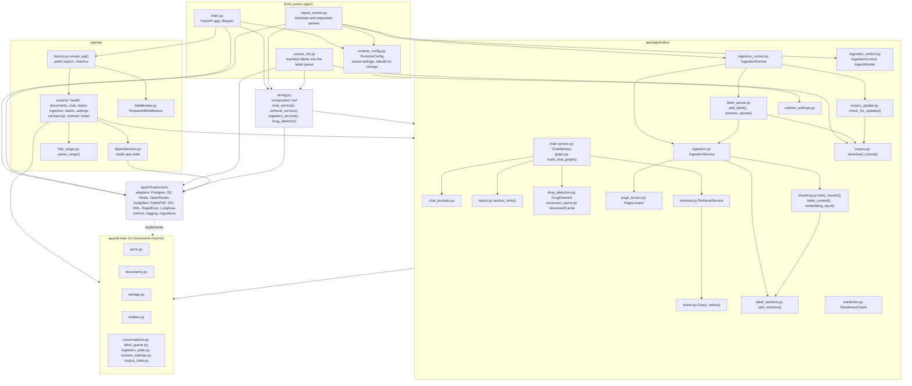
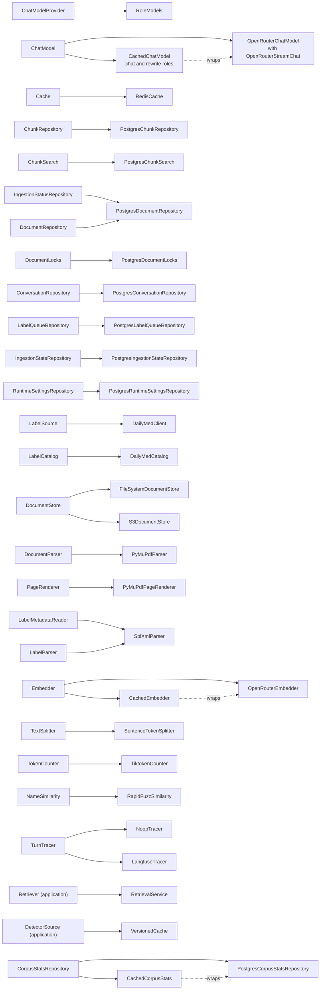

# Backend layers

Dependencies point inward to `app/domain`. `app/wiring.py`, `app/main.py` and the commands connect the adapters to the ports. The first diagram shows the modules and their imports. The second diagram shows which adapter implements which port.

Port to adapter map. The ports are in `app/domain` unless the label names `application`.

