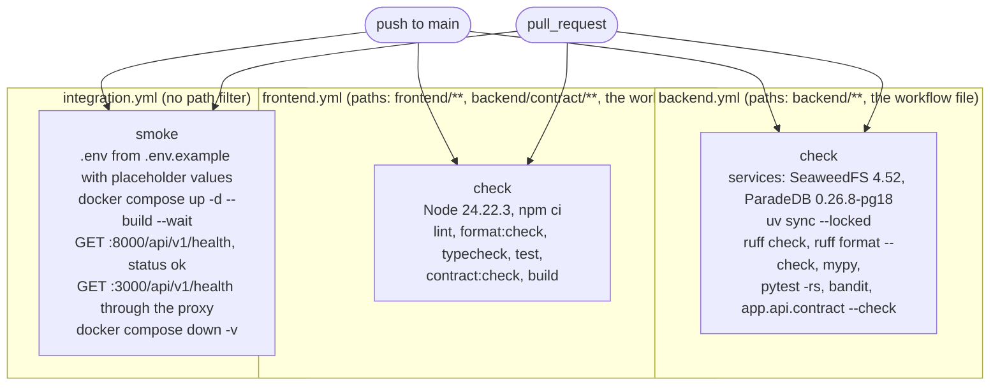

# CI/CD

Three GitHub Actions workflows in `.github/workflows/`. `backend` and `frontend` are path-filtered. `integration` runs on every push to `main` and every pull request.

All jobs run on `ubuntu-24.04` with `permissions: contents: read`.
