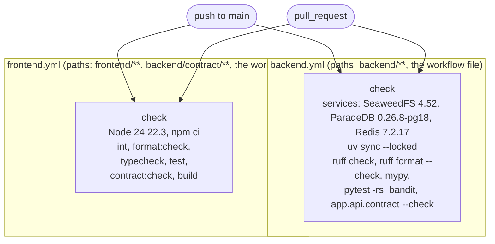

# CI/CD

Two GitHub Actions workflows in `.github/workflows/`. Both are path-filtered and run on a push to `main` and on a pull request.

All jobs run on `ubuntu-24.04` with `permissions: contents: read`.
