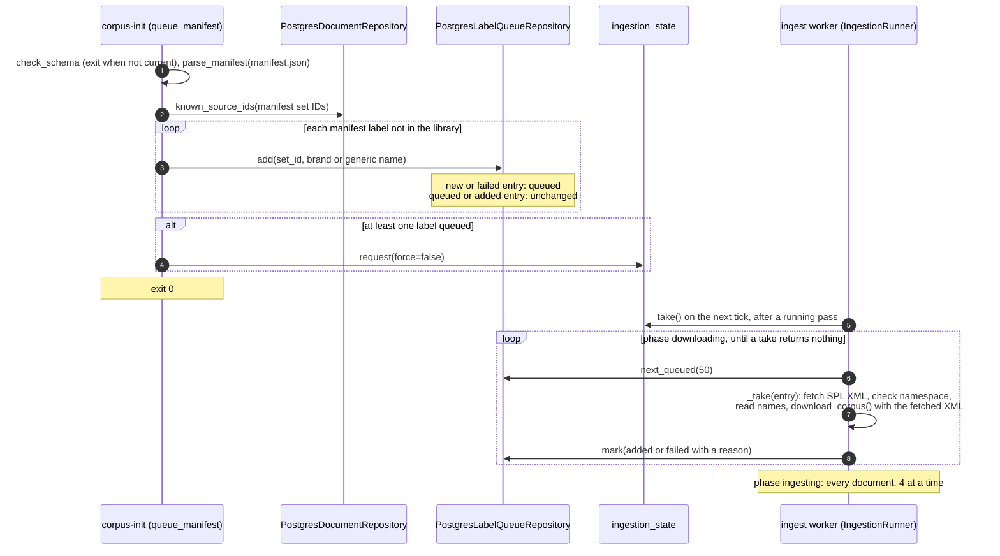
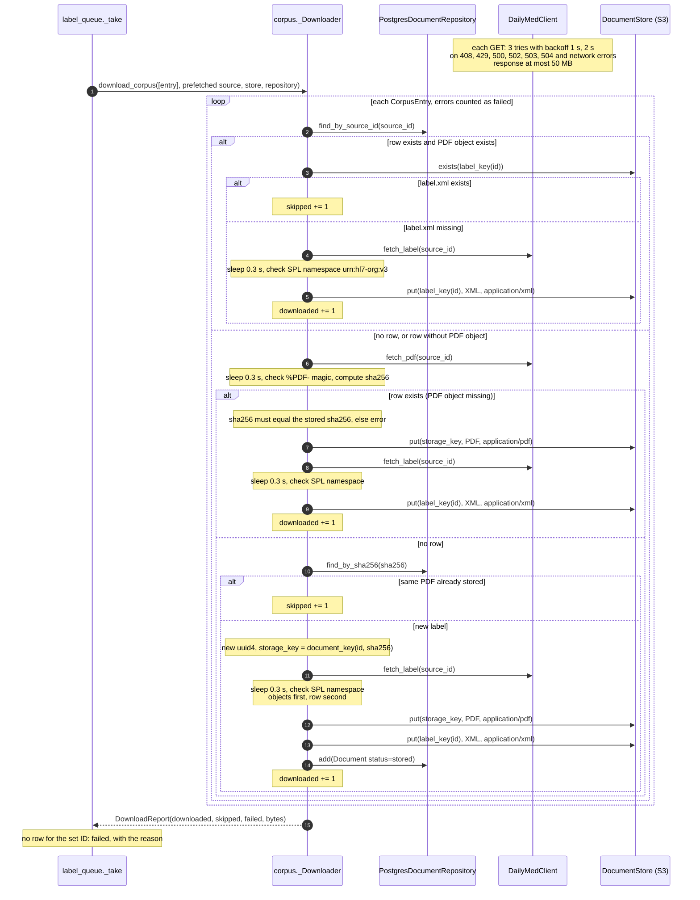

# Corpus download

The ingest worker is the only process that downloads labels. Labels come into the label queue from two places: the Corpus page (`POST /api/v1/labels`) and the one-shot `corpus-init` job. `download_corpus()` stores the label PDF and the SPL XML of a label, then adds the document row. It is idempotent by `source_id`.

## Fill the library: corpus-init and the label queue

`python -m app.worker.corpus_init` runs once per stack start. The manifest is `backend/corpus/manifest.json`, mounted at `/corpus/manifest.json`.

## One label: download_corpus()

