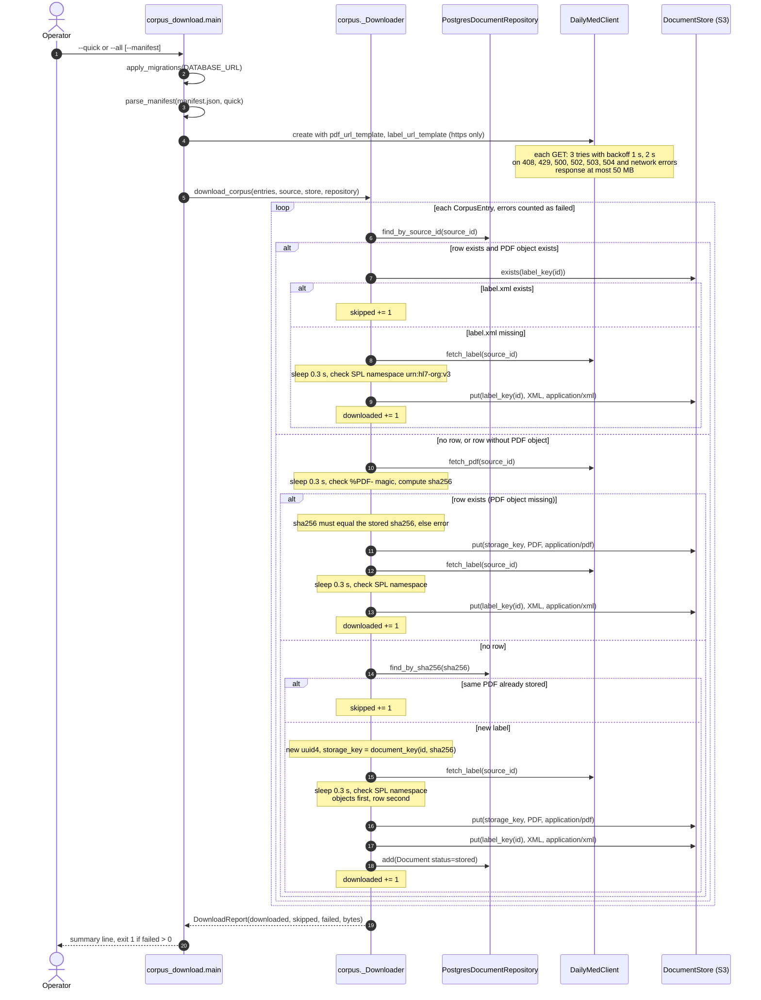

# Corpus download

`python -m app.corpus_download --quick|--all` stores the label PDF and the SPL XML of each manifest entry, then adds the document row. The run is idempotent by `source_id`. The manifest is `backend/corpus/manifest.json`, mounted at `/corpus/manifest.json`.

Other callers of `download_corpus()`: the one-shot `corpus-init` job runs `corpus_download.main(["--all"])`, then `ingest.main(["--all"])`, when a manifest label is not in the library. The label queue of the ingest worker (`label_queue.process_queue()`) calls it for one label at a time, with the SPL XML that it already fetched.

