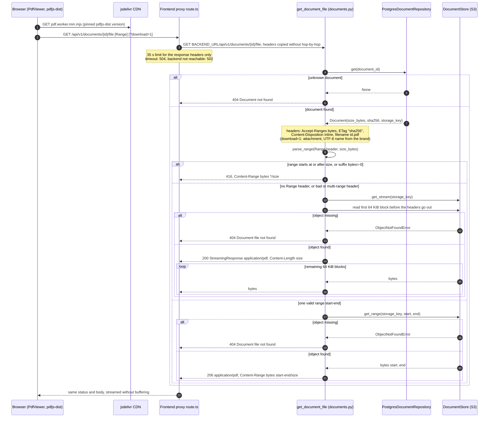
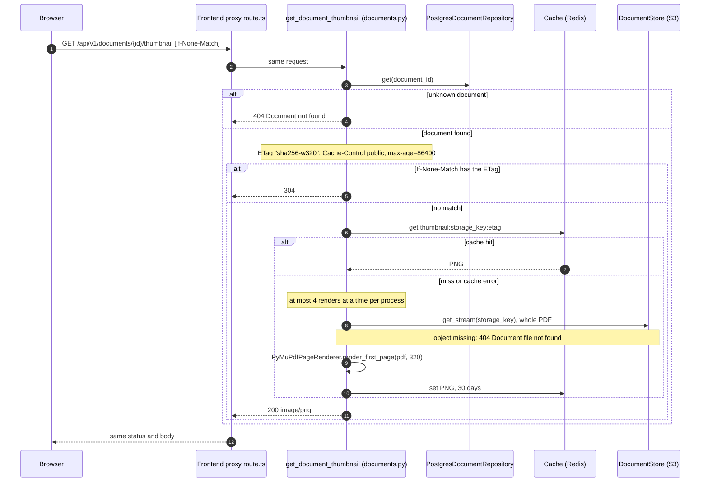

# Document file

`GET /api/v1/documents/{id}/file` sends the stored PDF. Without a `Range` header it streams the whole file (200). With one valid byte range it sends that range (206). `GET /api/v1/documents/{id}/file/{filename}` sends the same PDF; the viewer saves a download under the last path segment. With `?download=1` the response is an attachment named after the drug.

The PDF viewer is `PdfViewer` of `@geomak/ui` (pdfjs-dist), in `DocumentViewer.tsx`. The Documents page and the source panel of the chat use it. It requests the file through the frontend proxy. It loads its worker script from the jsdelivr CDN (`https://cdn.jsdelivr.net/npm/pdfjs-dist@<version>/build/pdf.worker.min.mjs`), so the viewer needs internet access.

`RequestIdMiddleware` adds `x-request-id` to every response, logs the request and counts it in the HTTP metrics.

## Thumbnail

`GET /api/v1/documents/{id}/thumbnail` sends a PNG of the first PDF page, 320 pixels wide. The Documents page shows it. The PNG goes into the shared Redis cache, so one render serves all API processes.

