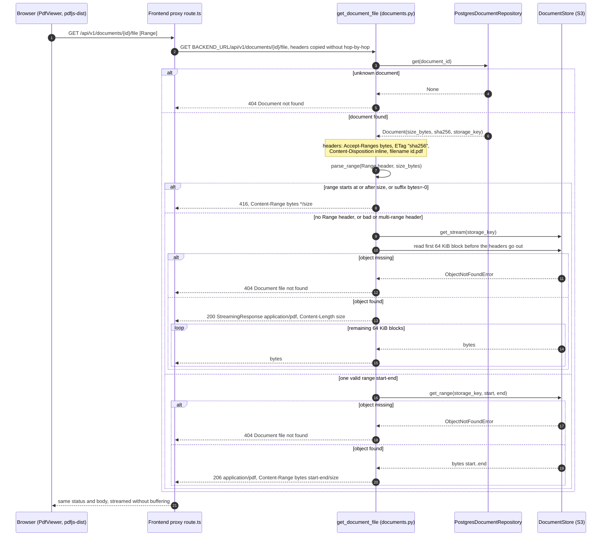

# Document file

`GET /api/v1/documents/{id}/file` sends the stored PDF. Without a `Range` header it streams the whole file (200). With one valid byte range it sends that range (206). The PDF viewer in `DocumentViewer.tsx` requests the file through the frontend proxy.

`RequestIdMiddleware` adds `x-request-id` to every response and logs the request.
