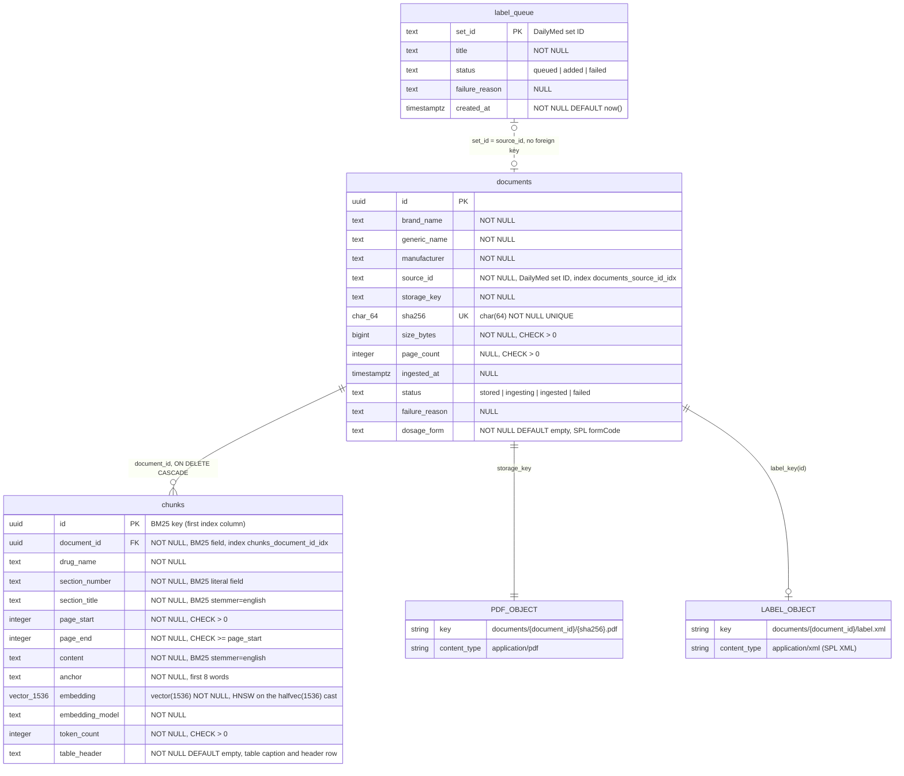
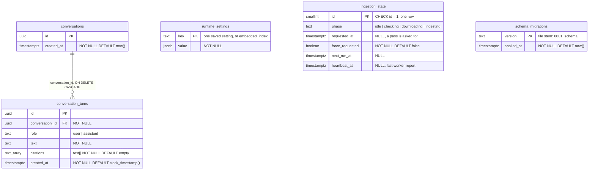

# Data model

Tables from the one schema file `backend/app/infrastructure/sql/0001_schema.sql`, and the SeaweedFS objects from `backend/app/domain/storage.py`. `migrations.py` applies each SQL file once, in name order, at the start of the backend, the ingest worker and corpus-init. It records each applied file in `schema_migrations`.

## Library

`PDF_OBJECT` and `LABEL_OBJECT` are S3 objects in the `S3_BUCKET` bucket, not tables. A label update stores a new PDF under a new key, updates `storage_key`, `sha256` and `size_bytes`, then deletes the old PDF object.

## Conversations, settings and worker state

`DELETE /api/v1/conversations/{id}` deletes a conversation; its turns go with it. The frontend sends it when the page unloads (`pagehide`).

## Indexes

| Index | Table | Type | Definition |
|---|---|---|---|
| `chunks_embedding_half_idx` | `chunks` | HNSW (pgvector) | `(embedding::halfvec(1536)) halfvec_cosine_ops`; half the size of a full-precision index; the query sets `hnsw.ef_search` to `SEARCH_HNSW_EF_SEARCH` (at least 2 times the limit) |
| `chunks_search_idx` | `chunks` | BM25 (pg_search, `USING paradedb`) | `id`, `content::pdb.simple('stemmer=english')`, `section_title::pdb.simple('stemmer=english')`, `document_id`, `section_number::pdb.literal`; `WITH (mutable_segment_rows = 0)` |
| `chunks_document_id_idx` | `chunks` | B-tree | `document_id` |
| `documents_source_id_idx` | `documents` | B-tree | `source_id` |
| `conversation_turns_conversation_idx` | `conversation_turns` | B-tree | `conversation_id, created_at` |

`chunks.drug_name` is still stored and sent to the model, but no index and no search filter use it now.
