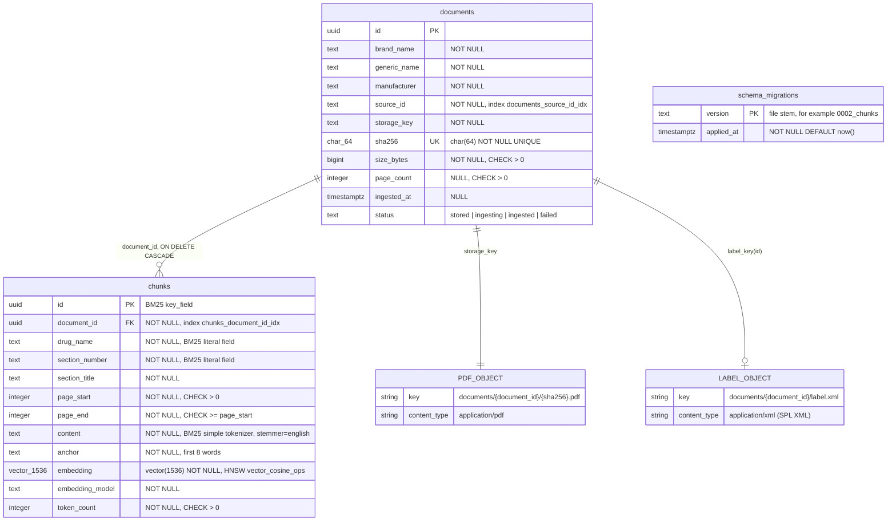

# Data model

Tables from `backend/app/infrastructure/sql/0001_documents.sql` and `0002_chunks.sql`, and the SeaweedFS objects from `backend/app/domain/storage.py`. `migrations.py` records each applied file in `schema_migrations`.

Indexes on `chunks`:

| Index | Type | Definition |
|---|---|---|
| `chunks_embedding_idx` | HNSW (pgvector) | `embedding vector_cosine_ops` |
| `chunks_search_idx` | BM25 (pg_search, `USING paradedb`) | `id`, `content::pdb.simple('stemmer=english')`, `drug_name::pdb.literal`, `section_number::pdb.literal`, `key_field = 'id'` |
| `chunks_document_id_idx` | B-tree | `document_id` |

`PDF_OBJECT` and `LABEL_OBJECT` are S3 objects in the `S3_BUCKET` bucket, not tables.
