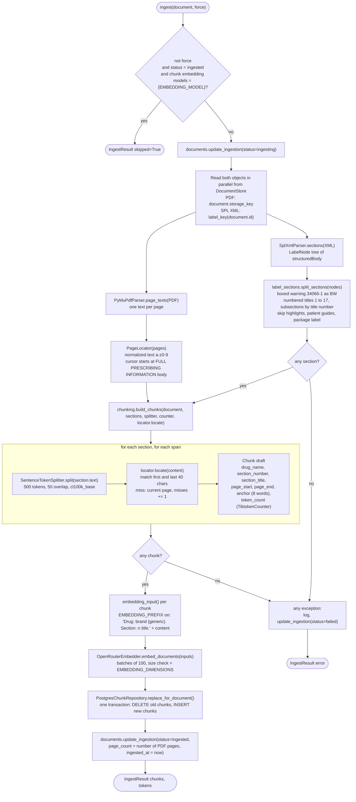

# Ingestion

`IngestionService.ingest()` takes the sections from the SPL XML and the page numbers from the PDF, then writes embedded chunks. `python -m app.ingest --quick|--all [--force]` runs it for each stored document.

Document status values: `stored` (after download), `ingesting`, `ingested`, `failed`.
