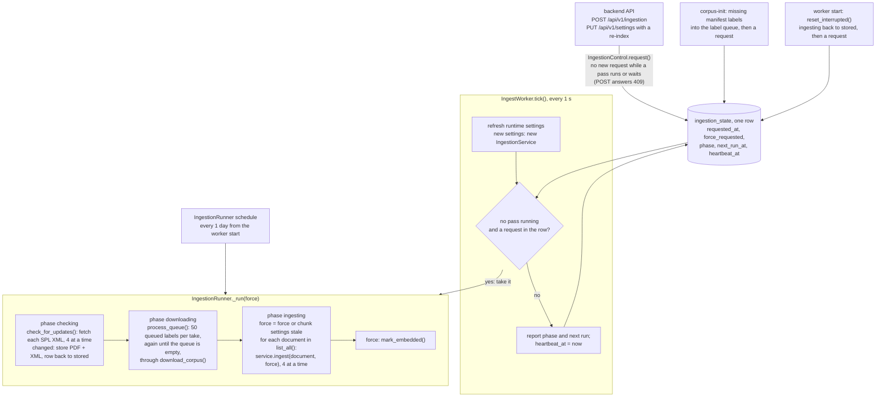
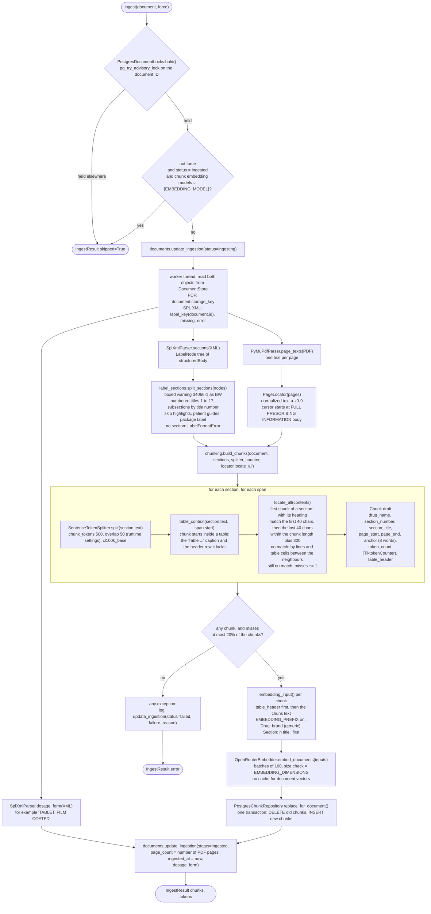

# Ingestion

`IngestionService.ingest()` takes the sections from the SPL XML and the page numbers from the PDF, then writes embedded chunks. Only the ingest worker runs it, one pass at a time, with at most 4 documents at the same time (`INGEST_CONCURRENCY`).

## Passes: API, ingest worker and schedule

`GET /api/v1/ready` reads the heartbeat: no report for 60 s means the worker is gone (an optional check, so the API stays ready). `GET /api/v1/status` shows the phase only while the heartbeat is current. The worker serves its metrics on port 9100.

## One document: ingest(document, force)

Document status values: `stored` (after download or a label update), `ingesting`, `ingested`, `failed`. `failure_reason` holds the message of a `ValueError` from our own checks, else only the exception type.

The stored chunk text stays as in the label. `table_header` is a separate column, so the page lookup, the anchor and the PDF highlight use the label text only.
