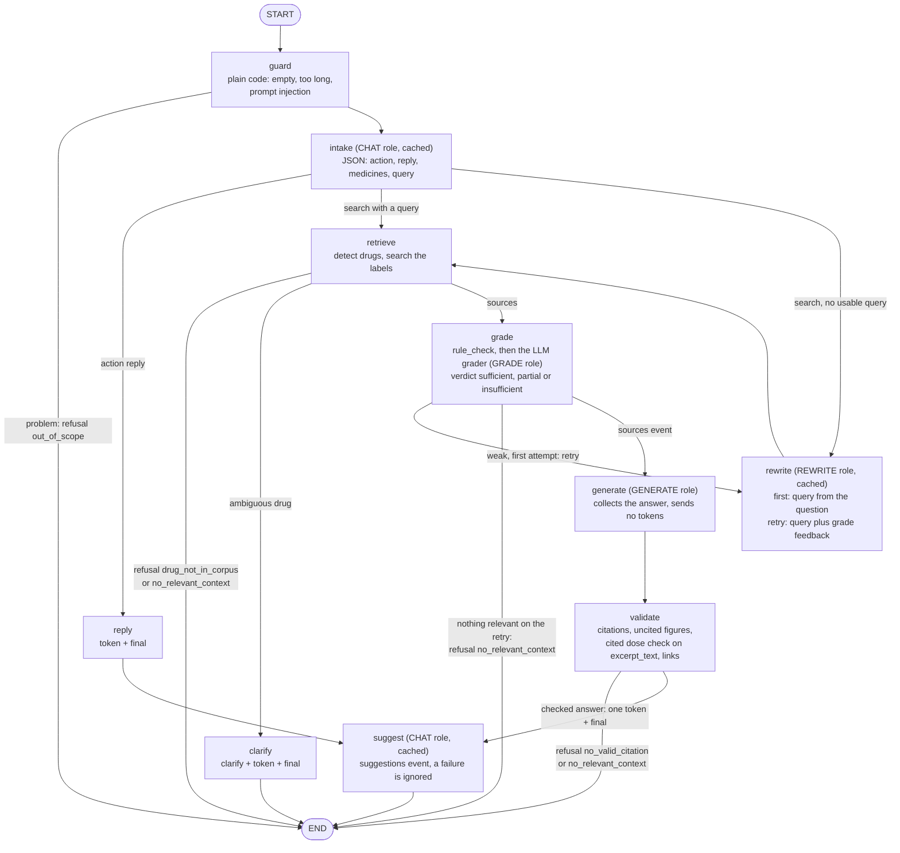
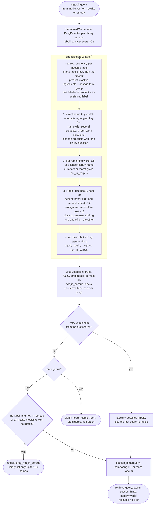
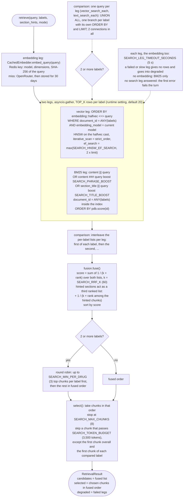

# Retrieval

The `retrieve` node of the chat graph (`app/application/chat/graph.py`) runs this path for each search. `DrugDetector` maps the search query to products and their preferred labels. `RetrievalService.retrieve()` searches only those labels (document IDs), in both legs. It fuses the two lists with RRF and selects the context.

## Chat turn graph

`build_chat_graph()` in `chat/graph.py` (LangGraph). `ChatService.ask()` runs it with the last 10 history messages and a 120 s deadline per turn. The nodes send stream events; the API sends them as SSE.

Stream event types: `status`, `sources`, `token`, `final`, `clarify`, `refusal`, `suggestions`, `error`. The rewrite node runs only when the intake gives no usable query (missing, or longer than 500 characters), or on the one retry after a weak grade. A retry merges the relevant excerpts of both searches. The grader mode (`off`, `rule`, `llm`) is a runtime setting; `llm` is the default.

## Drug detection and the search decision

## Hybrid search, fusion and selection

Modes: `vector` runs only the vector leg, `bm25` only the BM25 leg, `hybrid` both. The chat uses `hybrid`. The eval runner sets the other modes.

Section hints come from `topics.py`: question words map to label sections, for example "breastfeed" to 8.2 and "dose" to 2. A comparison without a topic gets sections 1, 2, 4, 5 and 6.

The model reads each selected chunk as `excerpt_text(chunk)`: the stored `table_header` (table caption and header row), then the chunk text.
