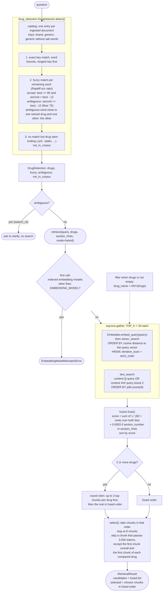

# Retrieval

`DrugDetector` finds the drug names in the question. `RetrievalService.retrieve()` runs the vector and BM25 searches in parallel with the same drug filter, fuses them with RRF and selects the context. Today only `search_cli.py` calls this path; no API route uses it yet.

Modes: `vector` runs only the vector search, `bm25` only the BM25 search, `hybrid` both.
