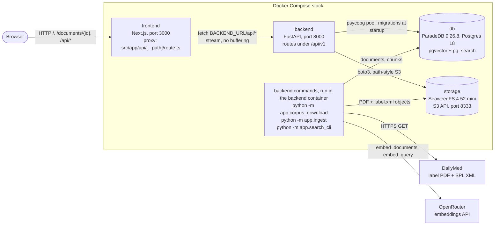
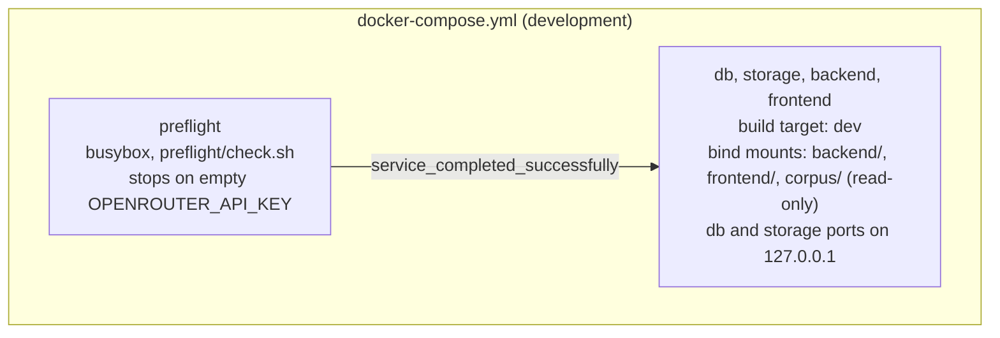

# System context

The browser calls only the frontend. The frontend proxy forwards `/api/*` to the backend. The backend uses ParadeDB, SeaweedFS and OpenRouter. The corpus command downloads labels from DailyMed.

Compose: one file, `docker-compose.yml`.

Start order: `db` and `storage` healthy, then `backend` healthy (`GET /api/v1/health`), then `frontend`.
