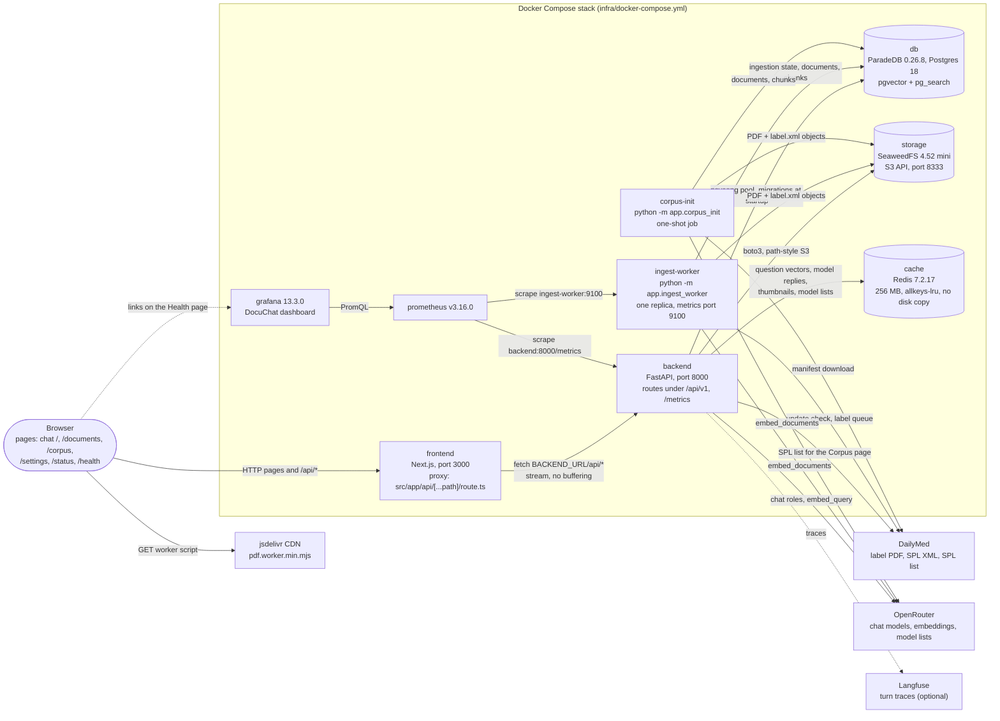
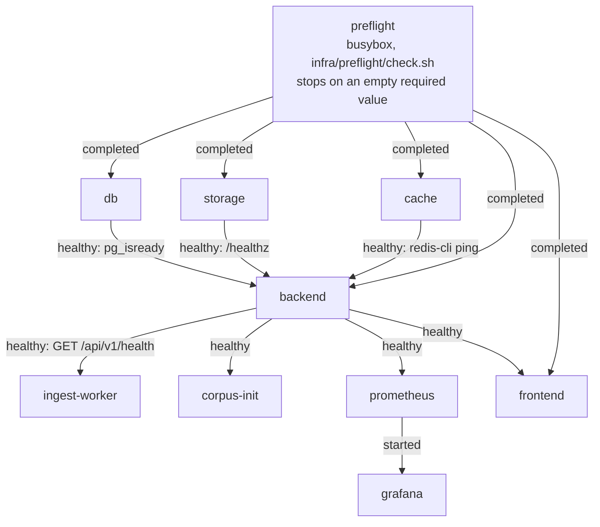

# System context

The browser calls only the frontend for pages and `/api/*`. The frontend proxy forwards `/api/*` to the backend. The PDF viewer loads the pdf.js worker from the jsdelivr CDN. The backend and the ingest worker use ParadeDB, SeaweedFS, the shared Redis cache, OpenRouter and DailyMed. Prometheus reads the metrics of the backend and the ingest worker.

The ingest worker and corpus-init get `CACHE_URL` too, but they embed document chunks only, and document vectors do not go through the cache.

Compose: one file, `infra/docker-compose.yml`, development mode only. Start it from the repository root with `docker compose -f infra/docker-compose.yml up`.

Configuration: one `.env` per project.

| File | Read by | Holds |
|---|---|---|
| `backend/.env` | preflight, backend, ingest-worker, corpus-init | OpenRouter key and models, embedding, `STORAGE_BACKEND`, `S3_BUCKET`, `S3_REGION`, Langfuse, `WEB_CONCURRENCY` |
| `infra/.env` | Compose interpolation | Postgres credentials, S3 keys, Grafana admin password, host ports |
| `frontend/.env` | frontend (optional) | Health page links, polling, `BACKEND_URL` and `CONTRACT_SOURCE` for a run outside Docker |

Compose sets `DATABASE_URL`, `CACHE_URL=redis://cache:6379/0` and the S3 endpoint and keys for the backend services. `infra/setup.sh` and `infra/setup.ps1` create the three files from their examples.

Ports: `backend` and `frontend` publish on all host interfaces. `db`, `storage`, `prometheus` and `grafana` publish on `127.0.0.1` only. `cache` publishes no port. The bind mounts are `backend/` and `frontend/` for hot reload, and `backend/corpus/` at `/corpus` (read-only) for the backend and corpus-init.
